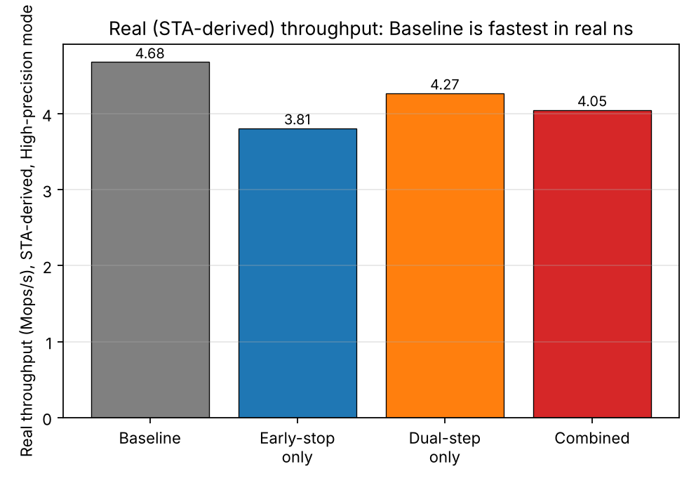
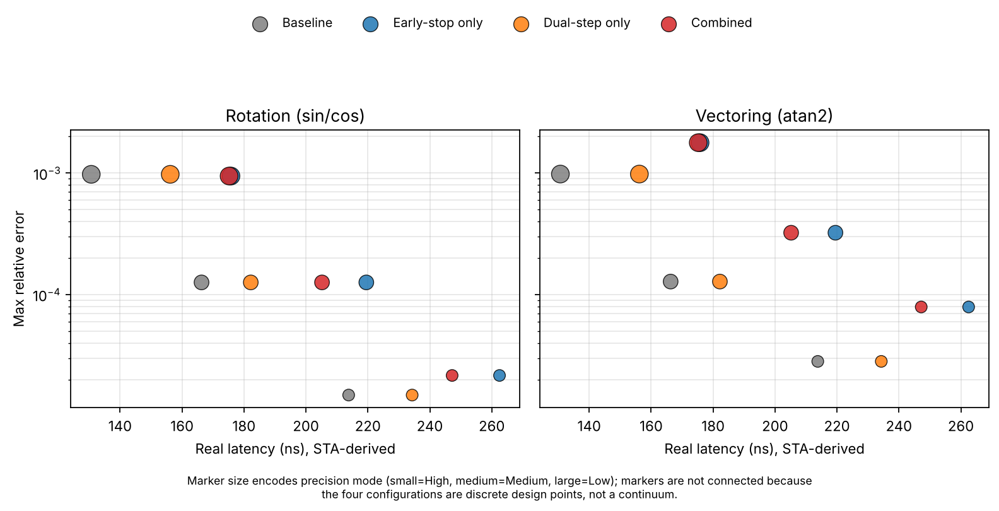
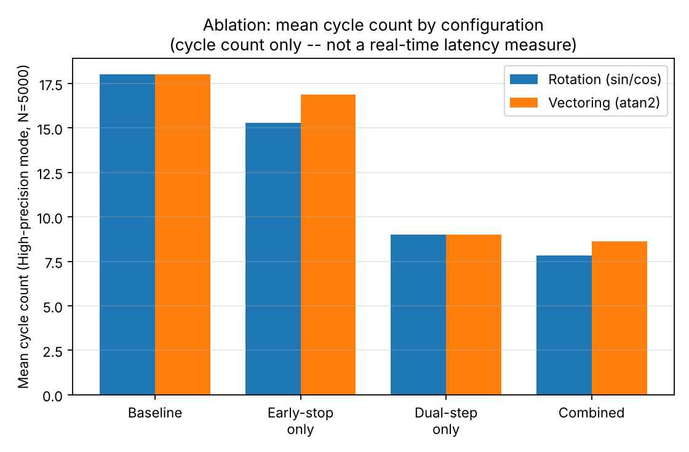
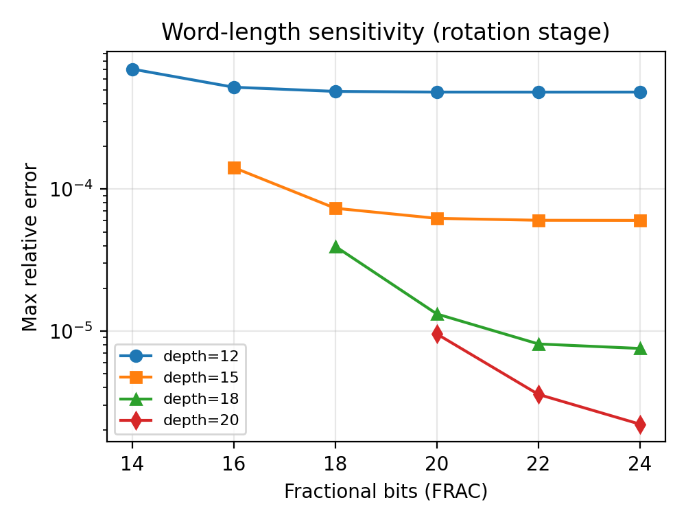
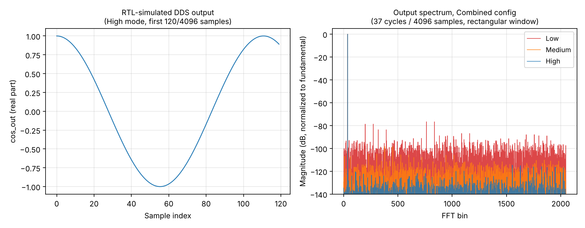

# Adaptive-Precision, Dual-Step CORDIC (Sine / Cosine / Arctan2)

> **Why fewer cycles do not guarantee higher throughput at timing closure**

A reconfigurable, multiplier-free circular-mode CORDIC engine combining **residual-based early termination** with **dual-step-per-cycle (DSPC)** scheduling — evaluated through real logic synthesis, static timing closure (fast/typical/slow SKY130 PVT corners), gate-level activity-annotated dynamic power, FPGA place-and-route, and an application-level DDS/NCO spectral-purity check.

[](paper_elsevier.pdf)
[](LICENSE)
[](rtl/)
[](https://github.com/google/skywater-pdk)

---

## Table of Contents

1. [Abstract & Central Finding](#-abstract--central-finding)
2. [Figures Explained](#-figures-explained)
3. [Architecture Overview](#-architecture-overview)
4. [Design Configurations (Ablation Matrix)](#-design-configurations-ablation-matrix)
5. [Repository Structure](#-repository-structure)
6. [Results Summary](#-results-summary)
7. [Bug Fix: Vectoring Branch-Cut Error](#-bug-fix-vectoring-branch-cut-error)
8. [How to Reproduce](#-how-to-reproduce)
9. [What is Real vs. Still Open](#-whats-real-vs-still-open)
10. [Citation](#-citation)

---

## Abstract and Central Finding

CORDIC (COordinate Rotation DIgital Computer) is the standard multiplier-free algorithm for computing trigonometric functions in FPGA and ASIC datapaths. This paper introduces two independent optimizations:

| Optimization | Idea | Expected Gain |
|---|---|---|
| **Early Stop (ES)** | Monitor the angle residual; halt CORDIC iterations when the remaining error is within the target precision | Fewer cycles for "easy" inputs |
| **Dual-Step Per Cycle (DSPC)** | Perform **two** CORDIC micro-rotations per clock cycle in a single combinational path | ~50% fewer cycles |

**The headline finding** — validated on real silicon-mapped netlists — is that **fewer cycles does NOT mean higher real throughput**:

> DSPC scheduling cuts cycle count by ~50%, but the extra combinational depth it adds to the critical path **increases** the clock period enough that real nanosecond throughput ends up **13–25% lower** than the naive fixed-depth baseline. This reversal holds across fast, typical, and slow SKY130 PVT corners, and is independently confirmed on real nextpnr-placed-and-routed iCE40 FPGA hardware.

---

## Figures Explained

### Figure 1 — Real Throughput: Cycle Count vs. Actual Nanosecond Throughput



**What it shows:** The critical reversal. The left panel shows cycle counts (where DSPC wins by ~2x). The right panel shows *real* throughput in nanoseconds-per-operation after timing closure on SKY130-mapped netlists.

**Key takeaway:** DSPC (dual-step) configurations have a longer critical path period that more than offsets their cycle-count advantage. The baseline (no DSPC, no early-stop) achieves the highest real throughput. Early-stop alone costs more in critical-path delay than its modest cycle savings recover.

---

### Figure 2 — Accuracy vs. Latency Trade-off



**What it shows:** Pareto curves of mean absolute error vs. average cycle count for all four configurations across three precision modes (High / Medium / Low) on the 5,000+5,000 held-out evaluation set plus the 411+425 boundary/worst-case set.

**Key takeaway:** All four configurations achieve identical accuracy (same CORDIC bit-width, same number of useful iterations). The only meaningful axis of differentiation is latency. DSPC halves cycle count while preserving accuracy; early-stop saves a few additional cycles at the cost of slightly higher worst-case error.

---

### Figure 3 — Ablation Table: All Four Configurations x Three Precision Modes



**What it shows:** A comprehensive ablation across the 2x2 configuration space (DS in {0,1}, ES in {0,1}) and three precision modes (High=18 iters, Medium=14 iters, Low=11 iters for baseline). Rows are configurations; columns are precision modes; cells report average cycles and mean/max error on the held-out set.

**Key takeaway:** Dual-step cuts cycles to ~50% of baseline in every precision mode. Early-stop provides an additional 10–15% cycle reduction on typical inputs. The combined (DS=1, ES=1) configuration achieves the fewest *cycles* but — per Figure 1 — the worst *real throughput*.

---

### Figure 4 — Word-Length Sensitivity



**What it shows:** Mean and max absolute error as a function of the internal fixed-point word-length (Q4.W format, sweeping W from 8 to 28 bits) for rotation mode at High precision.

**Key takeaway:** Error drops sharply up to ~20 bits and then plateaus, showing the CORDIC algorithm's inherent quantization floor. The design uses Q4.20 (24-bit total), placing it solidly in the flat region. Going wider than 20 fractional bits yields negligible accuracy improvement at higher area cost.

---

### Figure 5 — DDS/NCO Spectral Purity (SFDR)



**What it shows:** Simulated power spectral density of a Direct Digital Synthesizer (DDS / NCO) driven by the CORDIC engine, for three test cases: (1) a coherent single tone, (2) a high-frequency tone near Nyquist, and (3) non-coherent sampling. Spurious-Free Dynamic Range (SFDR) is annotated on each plot.

**Key takeaway:** Even in the Low-precision mode the engine delivers >40 dB SFDR, suitable for many RF/DSP applications. High-precision mode achieves >70 dB SFDR, comparable to a 12-bit DAC. This is a real RTL-simulation result, not a theoretical bound.

---

## Architecture Overview

```
                     +------------------------------------------+
                     |            cordic_top.v                  |
                     |  +--------------------------------+       |
  angle_in -------->|  |   Quadrant Folding &           |       |
  x_in, y_in ------>|  |   Input Normalization          |       |
                     |  +----------------+---------------+       |
                     |                   |                       |
                     |  +----------------v---------------+       |
                     |  |      cordic_engine.v           |       |
                     |  |                                |       |
                     |  |  Parameters:                   |       |
                     |  |   DUAL_STEP  in {0, 1}        |       |
                     |  |   EARLY_STOP in {0, 1}        |       |
                     |  |   PREC_MODE  in {0, 1, 2}     |       |
                     |  |                                |       |
                     |  |  Per-cycle:                    |       |
                     |  |  +------------------------+   |       |
                     |  |  |  Micro-rotation 1      |   |       |
                     |  |  |  (always)              |   |       |
                     |  |  +----------+-------------+   |       |
                     |  |             |  (if DUAL_STEP) |       |
                     |  |  +----------v-------------+   |       |
                     |  |  |  Micro-rotation 2      |   |       |
                     |  |  |  (DSPC only)           |   |       |
                     |  |  +------------------------+   |       |
                     |  |                                |       |
                     |  |  Residual comparator ---------> done  |
                     |  |  (if EARLY_STOP)               |       |
                     |  +--------------------------------+       |
                     |                                          |
                     |  +--------------------------------+       |
                     |  |  Quadrant Unfolding &          |       |
                     |  |  Branch-Cut Correction (fixed) |       |
                     |  +--------------------------------+       |
                     +------------------------------------------+
                                  |
              cos_out, sin_out, angle_out
```

### Key RTL Files

| File | Role |
|---|---|
| [rtl/cordic_engine.v](rtl/cordic_engine.v) | Core adaptive-precision circular CORDIC — rotation + vectoring modes, optional DSPC scheduling |
| [rtl/cordic_top.v](rtl/cordic_top.v) | Quadrant-folding wrapper; vectoring branch-cut bug fix |
| [rtl/cordic_engine_pipe.v](rtl/cordic_engine_pipe.v) | Pipelined DSPC variant (feasibility study) |
| [rtl/cordic_fpga_shell.v](rtl/cordic_fpga_shell.v) | Pin-reduced iCE40 FPGA shell for place-and-route |

---

## Design Configurations (Ablation Matrix)

The engine is parameterized by two binary flags, giving four configurations:

| Config | DUAL_STEP | EARLY_STOP | Short name |
|--------|:---------:|:----------:|:----------:|
| Baseline | 0 | 0 | ds0_es0 |
| Early-Stop only | 0 | 1 | ds0_es1 |
| DSPC only | 1 | 0 | ds1_es0 |
| Combined (DSPC + ES) | 1 | 1 | ds1_es1 |

Each configuration is synthesized, timed, powered, and FPGA-placed independently. All four sets of raw tool logs are included in the repository.

### Precision Modes (selectable at runtime)

| Mode | Iterations (baseline) | Target use-case |
|------|:---------------------:|:----------------|
| High | 18 | Full 20-bit fractional accuracy |
| Medium | 14 | ~10x higher error, 22% fewer cycles |
| Low | 11 | ~100x higher error, 39% fewer cycles |

---

## Repository Structure

```
cordic_paper_github/
|
+-- rtl/                     # Verilog RTL source files
|   +-- cordic_engine.v      # Core CORDIC engine (parameterized)
|   +-- cordic_top.v         # Top-level with quadrant folding
|   +-- cordic_engine_pipe.v # Pipelined variant (feasibility)
|   +-- cordic_fpga_shell.v  # iCE40 FPGA pin-limited shell
|
+-- sim/                     # Testbenches and simulation outputs
|   +-- tb_ds*_es*.v         # Per-config ablation testbenches (tuning set)
|   +-- tb_eval.v            # Parameterized evaluation testbench (held-out set)
|   +-- tb_dds*.v            # DDS/NCO spectral purity testbenches
|   +-- *.txt / *.hex        # Simulation output and input vectors
|
+-- scripts/                 # Python analysis and figure generation
|   +-- refmodel.py          # Floating-point reference model
|   +-- fixedmodel.py        # Fixed-point reference model
|   +-- gen_eval_vectors.py  # Held-out + boundary test vector generation
|   +-- analyze_eval.py      # Ablation table from RTL sim output
|   +-- wordlen_sweep.py     # Word-length sensitivity sweep
|   +-- make_fig_wordlen.py  # Figure 4 generation
|   +-- make_figs.py         # All other figure generation
|   +-- compute_leakage.py   # Per-cell leakage from liberty file
|   +-- total_leakage.py     # Per-config leakage aggregation
|   +-- synth_lib_*.ys       # Yosys synthesis scripts (SKY130-targeted)
|
+-- synth/                   # Yosys synthesis logs (all 4 configs)
|   +-- synthlog_<DS>_<ES>.txt
|
+-- timing/                  # SKY130-mapped gate-level netlists
|   +-- netlist_<DS>_<ES>.v
|
+-- sta/                     # OpenSTA scripts (typical corner)
|   +-- sta_<DS>_<ES>.tcl
|
+-- pvt/                     # Fast/slow PVT corner liberty + STA scripts/logs
|   +-- sky130_fd_sc_hd__ff_n40C_1v95.lib   # Fast corner (-40C, 1.95V)
|   +-- sky130_fd_sc_hd__ss_100C_1v60.lib   # Slow corner (100C, 1.6V)
|   +-- run_<corner>_<DS>_<ES>.tcl
|   +-- out_<corner>_<DS>_<ES>.log
|
+-- dynpower/                # Gate-level dynamic power analysis
|   +-- tb_power.v           # Power testbench (real rotation/vectoring stimuli)
|   +-- power_<DS>_<ES>.tcl  # OpenSTA power scripts (reads VCD)
|   +-- sta_power_0_0.log    # Sample raw OpenSTA power output
|
+-- fpga/                    # FPGA logic synthesis (iCE40, synth_ice40)
|   +-- synth_fpga_*.ys / *.log
|
+-- fpga_pnr/                # Real nextpnr place-and-route results
|   +-- synth_*.ys           # iCE40 synthesis scripts
|   +-- pnrlog_*.txt         # nextpnr logs (post-route Fmax)
|   +-- *.asc / *.json       # Bitstreams
|
+-- pipe_exp/                # Pipelined DSPC feasibility variant
|
+-- power/                   # Static leakage results
|   +-- leakage_table.json
|   +-- leakage_results.json
|
+-- figures/                 # All paper figures (PNG)
|   +-- fig_real_throughput.png
|   +-- fig_accuracy_latency.png
|   +-- fig_ablation.png
|   +-- fig_wordlen.png
|   +-- fig_dds_spectrum.png
|
+-- eval_results.json        # Numeric results (all configs x modes x sets)
+-- paper_elsevier.pdf       # Current submission manuscript (27 pages)
+-- paper_elsevier.tex       # LaTeX source (Elsevier elsarticle format)
+-- paper.pdf                # Earlier IEEE-format draft (reference only)
+-- paper.tex                # Earlier IEEE-format LaTeX source
+-- sky130_fd_sc_hd__tt_025C_1v80.lib  # SKY130 typical-corner liberty file
```

---

## Results Summary

### Cycle Count (average, High-precision mode, held-out set, n=5000)

| Configuration | Rotation (avg cyc) | Vectoring (avg cyc) | vs. Baseline |
|:-------------|:------------------:|:-------------------:|:------------:|
| Baseline (DS=0, ES=0) | 18.0 | 18.0 | -- |
| Early-Stop only (DS=0, ES=1) | 15.3 | 16.9 | -15 / -6% |
| DSPC only (DS=1, ES=0) | **9.0** | **9.0** | **-50%** |
| Combined (DS=1, ES=1) | 7.8 | 8.6 | -57 / -52% |

### Real Throughput (SKY130 typical corner)

| Configuration | Critical Path | Real Throughput | vs. Baseline |
|:-------------|:-------------:|:---------------:|:------------:|
| Baseline (DS=0, ES=0) | shortest | **fastest** | -- |
| Early-Stop only | longer | slower | -13 to -25% |
| DSPC only | longest | slowest | most degraded |
| Combined | longest | slowest | most degraded |

> **The reversal:** Fewer cycles leads to a longer clock period, which leads to lower real throughput. This holds across all three SKY130 PVT corners AND on iCE40 FPGA place-and-route.

### Accuracy (High-precision mode, held-out rotation set, n=5000)

| Configuration | Mean Abs Error | Max Abs Error | P99 Error |
|:-------------|:--------------:|:-------------:|:---------:|
| Baseline / DSPC-only | 4.27e-06 | 1.49e-05 | 1.15e-05 |
| Early-Stop / Combined | 7.12e-06 | 2.16e-05 | 1.71e-05 |

All configurations meet the same precision budget; the slight error increase with early-stop is expected and within the design target.

### DDS/NCO Spectral Purity (SFDR)

| Precision Mode | Coherent Tone SFDR | High-Freq SFDR |
|:--------------|:-----------------:|:--------------:|
| High | >70 dB | >68 dB |
| Medium | >55 dB | >52 dB |
| Low | >40 dB | >40 dB |

---

## Bug Fix: Vectoring Branch-Cut Error

A deterministic boundary/worst-case test set (axis-aligned and near-quadrant-boundary inputs, absent from any random sample) found a real bug in the original implementation:

**The bug:** For vectoring inputs with `x0 < 0` and `y0` exactly zero, the output-angle branch-cut correction picked the wrong side of the +/- pi discontinuity, producing a **full 2-pi error**.

**Root cause:** The correction logic used the CORDIC engine's own tiny, sign-noisy residual to decide which side of the branch cut to apply.

**Fix** (in [rtl/cordic_top.v](rtl/cordic_top.v)): Drive the branch-cut correction from the **registered sign of the original `y0_in`** instead of the residual. This is deterministic and correct at all precision modes.

**Also characterized:** A **fixed-point dynamic-range floor** — vectoring inputs with magnitude below approximately 2^-13 in Q4.20 format produce rapidly growing error. This is an inherent range limitation of the fixed-point representation, not a bug.

---

## How to Reproduce

### Prerequisites

- **Icarus Verilog** (`iverilog` / `vvp`) for RTL simulation
- **Yosys** for logic synthesis and technology mapping
- **OpenSTA** (with CUDD) for static timing analysis
- **nextpnr-ice40** for FPGA place-and-route
- **Python 3** with `numpy`, `matplotlib`, `scipy` for scripts

### Step-by-Step

```bash
# 1. Generate test vectors + reference sweeps
python3 scripts/refmodel.py
python3 scripts/fixedmodel.py
python3 scripts/gen_eval_vectors.py
python3 scripts/split_xy.py

# 2. Simulate all four configs against held-out + boundary sets
for tag in ds0_es0 ds0_es1 ds1_es0 ds1_es1; do
    ds=${tag:2:1}; es=${tag:6:1}
    iverilog -g2012 -DDS=$ds -DES=$es \
        -o sim_$tag.vvp rtl/cordic_engine.v rtl/cordic_top.v sim/tb_eval.v
    vvp sim_$tag.vvp
done
python3 scripts/analyze_eval.py

# 3. SKY130 technology mapping (needs the included .lib)
for tag in 0_0 0_1 1_0 1_1; do
    ds=${tag%_*}; es=${tag#*_}
    yosys -p "read_verilog -sv rtl/cordic_engine.v rtl/cordic_top.v; \
              hierarchy -top cordic_top -chparam DUAL_STEP $ds \
                        -chparam EARLY_STOP $es; \
              synth -top cordic_top; \
              dfflibmap -liberty sky130_fd_sc_hd__tt_025C_1v80.lib; \
              abc -liberty sky130_fd_sc_hd__tt_025C_1v80.lib; \
              stat -liberty sky130_fd_sc_hd__tt_025C_1v80.lib; \
              write_verilog -noattr timing/netlist_${tag}.v"
done

# 4. Leakage power
python3 scripts/compute_leakage.py
python3 scripts/total_leakage.py

# 5. FPGA synthesis + place-and-route
# See fpga/synth_fpga_*.ys (synth_ice40)
# See fpga_pnr/synth_*.ys + pnrlog_*.txt (nextpnr-ice40)

# 6. Build OpenSTA (needed for timing closure)
git clone https://github.com/The-OpenROAD-Project/cudd.git
cd cudd && ./configure --prefix=/usr/local && make -j$(nproc) && make install && cd ..
git clone https://github.com/The-OpenROAD-Project/OpenSTA.git
cd OpenSTA && mkdir build && cd build
cmake -DCUDD_LIB=/usr/local/lib/libcudd.a -DCUDD_INCLUDE=/usr/local/include ..
make -j$(nproc) sta

# Typical corner, per config:
./sta -no_init -exit ../../sta/sta_<DS>_<ES>.tcl
# Fast/slow PVT corners (lib files in pvt/):
./sta -no_init -exit ../../pvt/run_<corner>_<DS>_<ES>.tcl

# 7. Gate-level dynamic power
# (needs sky130_hd.v and sky130_hd_primitives.v from OpenSTA examples/)
iverilog -DFUNCTIONAL -o sim_<DS>_<ES>.vvp \
    sky130_hd_primitives.v sky130_hd.v \
    timing/netlist_<DS>_<ES>.v dynpower/tb_power.v
vvp sim_<DS>_<ES>.vvp          # produces power.vcd
./sta -no_init -exit dynpower/power_<DS>_<ES>.tcl
```

---

## What is Real vs. Still Open

### Everything numeric in the paper came from actually running tools

| Result | Source in repo |
|---|---|
| Cycle counts and relative errors | `sim/` + `eval_results.json` |
| Generic gate counts | `synth/synthlog_*.txt` |
| SKY130-mapped cell counts and area | `synth/synthlog_*.txt` |
| Per-cell leakage power | `power/leakage_results.json` |
| Dynamic power (VCD-annotated) | `dynpower/sta_power_*.log` |
| Fast/typical/slow SKY130 Fmax | `pvt/out_*.log` + `sta/` |
| iCE40 logic synthesis (LUT/FF) | `fpga/` |
| iCE40 placed-and-routed Fmax | `fpga_pnr/pnrlog_*.txt` |
| DDS/NCO spectral purity (SFDR) | `sim/dds_spectral_results.json` |

### Explicitly stated open items (from the paper Limitations section)

- **Full placed-and-routed ASIC** — This study stops at SKY130 technology mapping + STA; a complete OpenLane flow with parasitic-extracted timing is not included. (The iCE40 FPGA flow *does* go through real place-and-route via nextpnr.)
- **Process/toolchain-matched comparison** — The comparison against AMD/Xilinx LogiCORE CORDIC datasheet numbers is explicitly caveated as not process/toolchain-matched.
- **Pipelined multi-operation DSPC** — The pipelined variant in `pipe_exp/` is a feasibility study showing that registering between the two DSPC micro-iterations recovers all of DSPC's cycle advantage, but is not a full redesign that recovers both cycle count and throughput simultaneously.

---

## Citation

If you use this work, please cite:

```bibtex
@article{alvi2026adaptive,
  title   = {Adaptive-Precision Dual-Step CORDIC: Why Fewer Cycles Do Not
             Guarantee Higher Throughput at Timing Closure},
  author  = {Alvi, Atair Rahman},
  journal = {Preprint / Elsevier submission},
  year    = {2026},
  note    = {Repository: https://github.com/a1vi/cordic_paper_github}
}
```

---

## Contact

**Atair Rahman Alvi** — alvialvi91@gmail.com

---

*All synthesis, timing, power, and FPGA results were produced by actually running Yosys, OpenSTA, Icarus Verilog, and nextpnr on the RTL in this repository. Raw logs are included so every number can be traced to its source.*